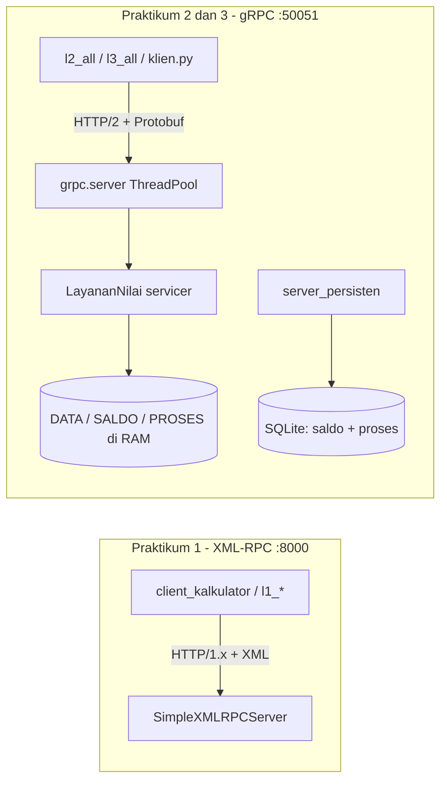
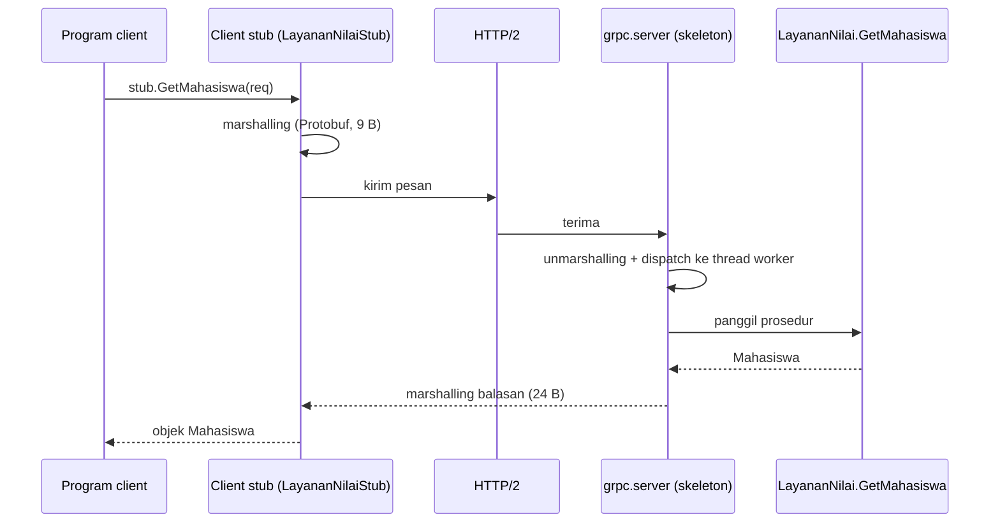
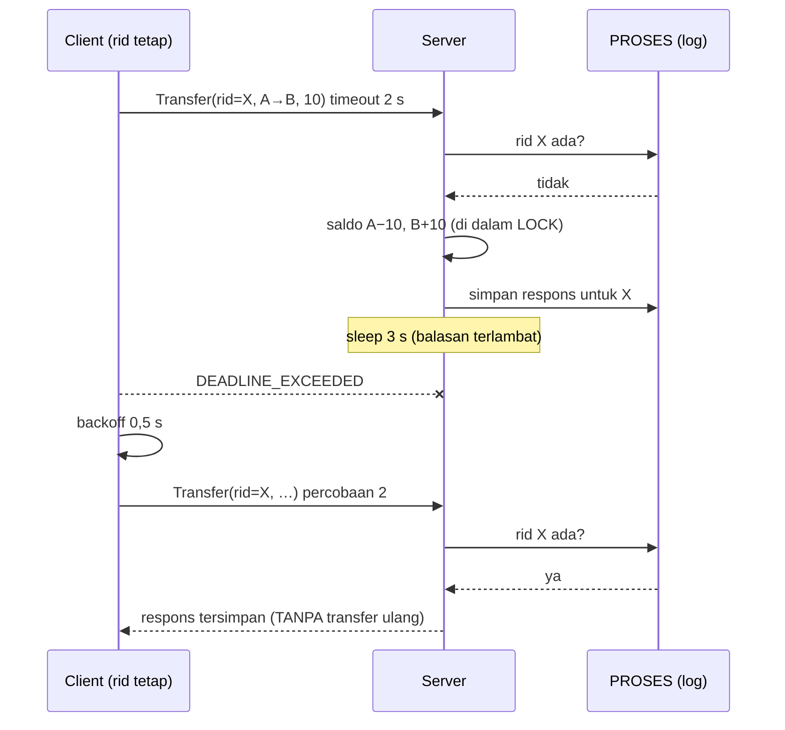
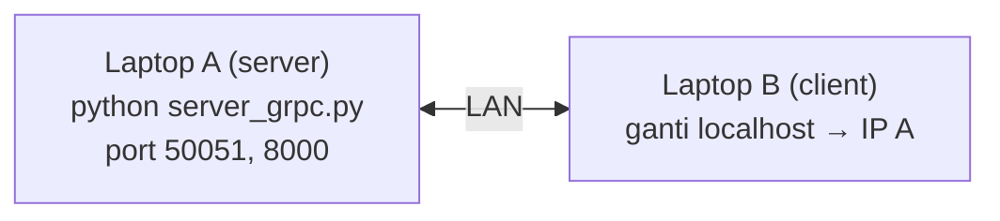

# Arsitektur — Praktikum RPC 1–3

## 1. Gambaran umum
Tiga praktikum memakai dua teknologi RPC pada pola client–server sederhana. Semua komponen berjalan di Python; server dan client dapat berada pada satu mesin (dua terminal) atau dua mesin.



## 2. Tata letak proyek
```

├── requirements.txt
├── README.md
├── praktikum1/                 # XML-RPC
│   ├── server_kalkulator.py    # tambah, kali, bagi, pangkat, akar, statistik, echo, lambat
│   ├── client_kalkulator.py    # Langkah 2 + L1.1, L1.2  (--verbose)
│   ├── l1_all.py               # driver L1.1-L1.5 (--bagian)
│   └── hasil/                  # log hasil eksekusi L1
├── grpc_app/                   # kontrak + server bersama P2 dan P3
│   ├── akademik.proto
│   ├── akademik_pb2*.py        # HASIL GENERATE (jangan diedit)
│   ├── server_grpc.py          # semua RPC, opsi --workers --delay --no-lock --race-window
│   ├── server_persisten.py     # Transfer + SQLite (jawaban analisis P3)
│   └── client_grpc.py          # Langkah 4
├── old_stub/                   # proto lama untuk L2.3
├── praktikum2/                 # harness.py, l2_all.py (L2.1-L2.5)
├── praktikum3/                 # klien.py (retry + failover), l3_all.py (L3.1-L3.5 + analisis)
├── praktikumN/hasil/         # output mentah, JSON, grafik per praktikum
└── docs/                       # dokumen ini
```

## 3. Kontrak layanan (`akademik.proto`)
| RPC | Tipe | Request → Response | Idempoten? | Dipakai |
|---|---|---|---|---|
| `GetMahasiswa` | unary | `MahasiswaRequest → Mahasiswa` | ✅ | P2, L2.3–L2.5, L3.4–L3.5 |
| `TambahNilai` | unary | `NilaiRequest → StatusResponse` | ✅ (menimpa nilai matkul yang sama) | P2 |
| `StreamNilai` | server streaming | `MahasiswaRequest → stream Nilai` | ✅ | P2 |
| `KirimBanyakNilai` | client streaming | `stream NilaiRequest → StatusResponse` | ✅ | L2.1 |
| `Diskusi` | bidirectional | `stream Pesan ↔ stream Pesan` | ❌ (efek: pesan terkirim) | L2.2 |
| `Transfer` | unary | `TransferRequest → StatusResponse` | ❌ → **dilindungi `request_id`** | P3 |
| `GetSaldo` | unary | `SaldoRequest → SaldoResponse` | ✅ | verifikasi P3 |

Nomor field `Mahasiswa.prodi = 4` ditambahkan belakangan (L2.3) — contoh evolusi skema yang kompatibel.

## 4. Urutan satu panggilan (stub → jaringan → servicer)


## 5. Alur `Transfer` dengan deduplikasi (at-most-once)

Pada `server_persisten.py` langkah "cek log → ubah saldo → simpan log" dijalankan dalam **satu transaksi SQLite** sehingga bertahan terhadap restart.

## 6. Model concurrency
| Aspek | Keputusan | Alasan |
|---|---|---|
| Server gRPC | `ThreadPoolExecutor(max_workers=N)`, opsi `--workers` | Setiap RPC aktif memegang 1 thread; N = batas paralelisme (diukur di L3.4) |
| State `SALDO`/`PROSES` | `threading.Lock` melingkupi cek-duplikat + ubah saldo + simpan log | Mencegah lost update dan duplikasi bersamaan |
| `sleep` simulasi balasan lambat | **di luar** lock | Agar lock tidak menahan semua transfer lain |
| `DATA` mahasiswa | `DATA_LOCK` untuk tulis; iterasi pada salinan | Hindari `dict changed size during iteration` |
| Ruang diskusi | `queue.Queue` per peserta + `ROOM_LOCK` untuk peta peserta | Pengiriman antar thread aman, tanpa saling blok |
| Persisten | SQLite `BEGIN IMMEDIATE` | Serialisasi lintas thread/proses + atomik |
| GIL | Diakui sebagai batas untuk handler CPU-bound | Beban uji bersifat menunggu (I/O-bound) |

## 7. Penanganan kegagalan
| Lapisan | Mekanisme |
|---|---|
| Client | `timeout=2.0` per RPC; retry maksimal 3 dengan jeda `0,5 × 2^(n−1)` s; hanya untuk `UNAVAILABLE`/`DEADLINE_EXCEEDED` |
| Operasi tidak idempoten | `request_id` (uuid4) dibuat **sekali** per operasi logis, dipakai ulang di setiap percobaan |
| Server | `context.abort(StatusCode, pesan)` untuk error terduga; dedup via `PROSES` / tabel `proses` |
| Failover | `FailoverClient`: daftar target, pindah pada error transport; hanya untuk operasi idempoten |
| XML-RPC | `Fault` (logika), `ProtocolError`, `ConnectionError`, `socket.timeout` ditangani terpisah |

Pemetaan error gRPC: tidak ditemukan → `NOT_FOUND`; input tidak valid → `INVALID_ARGUMENT`; server tidak terjangkau → `UNAVAILABLE`; terlalu lama → `DEADLINE_EXCEEDED`.

## 8. Deployment dua komputer

Langkah: cek IP server (`ip a` / `ipconfig`), buka port di firewall, ubah `localhost` → IP pada client (`praktikum1/l1_all.py --bagian 4 --host <IP>`, atau `grpc.insecure_channel("<IP>:50051")`).

## 9. Keputusan arsitektur (ringkas)
| # | Keputusan | Alternatif | Alasan |
|---|---|---|---|
| ADR-1 | Satu server gRPC untuk semua RPC | Server per praktikum | Sesuai modul (menambah RPC ke layanan yang sama), kurang duplikasi |
| ADR-2 | Flag CLI untuk perilaku eksperimen | Mengedit kode tiap uji | Eksperimen otomatis dan terulang |
| ADR-3 | Jendela race diperlebar sebagai demonstrasi *tambahan* | Hanya hapus lock | Hapus-lock saja tidak memunculkan race pada CPython |
| ADR-4 | SQLite untuk dedup persisten | Redis / file JSON | Tanpa dependensi, transaksi ACID bawaan |
| ADR-5 | Tambah `GetSaldo` dan `jumlah` | Mem-parse teks respons | Verifikasi otomatis yang andal |
